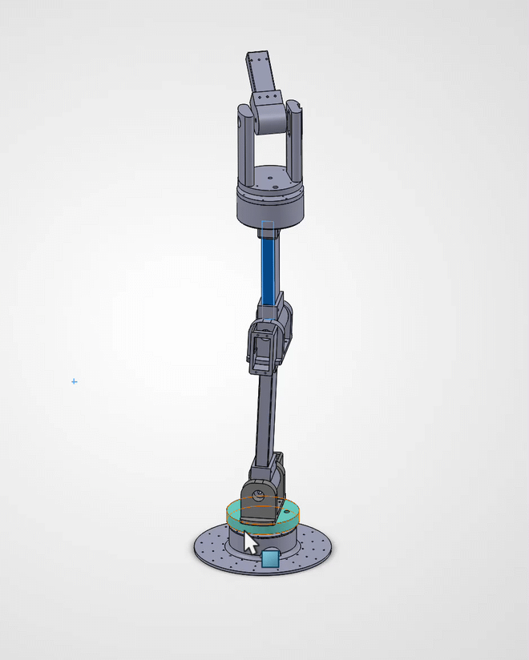

<h1>Robotic Arm (ROS2) <br/>
<sub><i>(Paused/Postponed due to school/other projects) </sub></i></h1> 

<h2>Description</h2>
Designed and build a 6DOF robotic arm (except the end effector) with a reach of 3 feet. I performed design analysis on the arms and servo motor. Used this project as my attempt at learning the ROS2 Jazzy environment and capabilities. Controlled all servos with ESP32 microcontroller with a PCA9685 PWM Driver. Created a URDF file derived from the arm assembly on Onshape. Used RViz to visualize the Robotic Arm and joints and created a MoveIt package to handle arm traits, such as physical limits and movement control. 
<br />


<h2>Resources Used</h2>

- <b>C/C++</b> 
- <b>Ubuntu (Linux)</b>
- <b>Onshape</b>
- <b>ESP32</b>
- <b>PCA9685</b>
- <b>3D-printed arm components</b>
- <b>Servo Motors (30kgcm, 80kgcm, 150kgcm) </b>
- <b>PLA, PETG, bearings, hex shafts, servo horns</b>

<h2>Environments Used </h2>

- <b>ROS2 Jazzy</b>

<h2>Project Photos:</h2>

<p align="center">
Robotic Arm Lower/Upper Link: <br/>

<br />
<br />
Arm movement in SolidWorks assembly:  <br/>

<br />
<br />
Enter the number of passes: <br/>

<br />
<br />
Confirm your selection:  <br/>

<br />
<br />
Wait for process to complete (may take some time):  <br/>

<br />
<br />
Sanitization complete:  <br/>

<br />
<br />
Observe the wiped disk:  <br/>

</p>

<!--
 ```diff
- text in red
+ text in green
! text in orange
# text in gray
@@ text in purple (and bold)@@
```
--!>
